<div align="center">
  <a href="https://synergy.holosai.io">
    
  </a>

  <h1>Synergy</h1>

  <p><strong>Durable agents. Your choice of files and compute.</strong></p>

  <p>
    An open-source agent platform that separates the Agent Runtime, Workspace, and execution Environment. Run locally, embed agents in your application, or connect a hosted runtime to remote execution resources.
  </p>

  <p>
    <a href="https://synergy.holosai.io">Website</a> · <a href="docs/README.md">Documentation</a> · <a href="#quick-start">Quick Start</a> · <a href="CONTRIBUTING.md">Contributing</a>
  </p>

  <p>
    <a href="https://github.com/SII-Holos/synergy/releases/latest"></a> <a href="https://github.com/SII-Holos/synergy/actions/workflows/ci.yml"></a> <a href="LICENSE"></a>
  </p>

<sub>Built by the <a href="https://github.com/SII-Holos">Holos</a> team at [Shanghai Innovation Institute](https://www.sii.edu.cn).</sub>

  <p align="center">
    <a href=".github/assets/readme/synergy-workspace.png">
      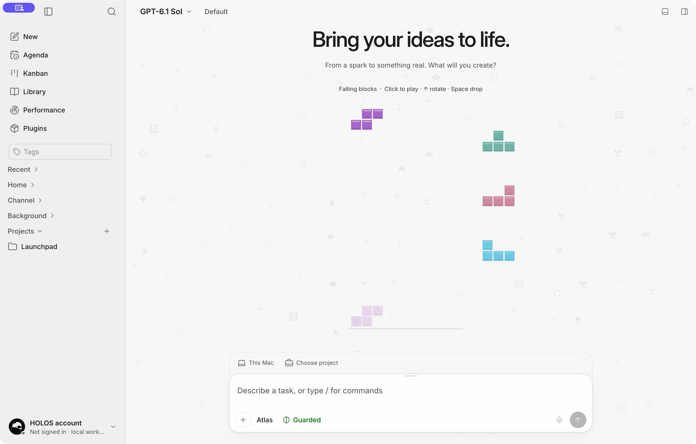
    </a>
  </p>

</div>

<p align="center"><sub>Start with an idea, a model, and a playable mini game on the new-task welcome screen.</sub></p>

## Agent Runtime, Workspace, Environment

The agent does not have to live where its files or commands live. Synergy gives each resource its own identity and lifecycle, so a conversation can persist while execution resources are allocated, released, or replaced.

| Concept           | Responsibility                                                                          | Choices                                                                                            |
| ----------------- | --------------------------------------------------------------------------------------- | -------------------------------------------------------------------------------------------------- |
| **Agent Runtime** | Model calls, sessions, tool scheduling, permissions, recovery, and durable agent state. | A local service, a hosted Bun process, or an embedded runtime with explicitly selected components. |
| **Workspace**     | The files a task reads and changes, with versioned bindings and change history.         | A native directory, a Git worktree, or content stored in a local object store, S3, or OSS.         |
| **Environment**   | The destination that runs commands, terminals, formatters, and language servers.        | Native execution or a managed Docker allocation on a local or remote Docker host.                  |

A Session selects its Workspace and Environment independently. **Scope** owns the project context, configuration, and scoped data; choosing different files or compute does not create a different project. API-only work needs no execution allocation, and dormant object-backed files can be read and edited without starting compute. See [Runtime and Scope](docs/architecture/runtime-and-scope.md), [Workspace and files](docs/architecture/workspace-and-files.md), and [Environments](docs/architecture/environments.md).

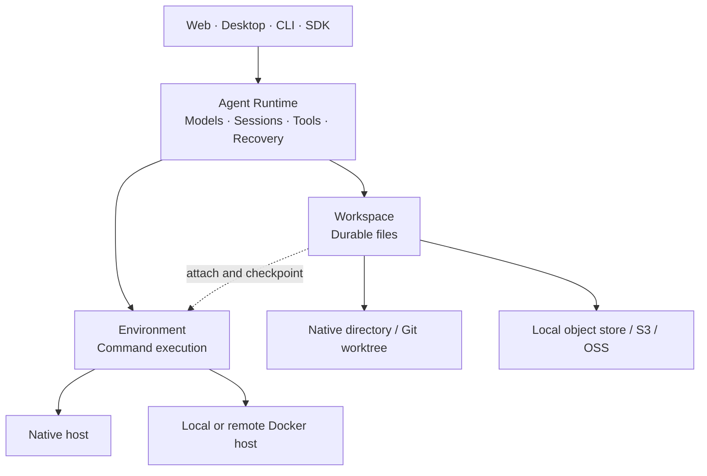

### Deployment across machines

Run everything on one computer for a personal workbench, or host the Agent Runtime on a server and use configured remote Docker Environments for execution. Object-backed Workspaces keep files independent of a disposable container; execution checkpoints save changes before compute is reclaimed. Remote execution uses authenticated transport and TLS. [Resource configuration](docs/reference/configuration-layout.md#locations) describes the supported setup.

For work across personal computers, connect to their Synergy services and use approved device pairing for remote access and manual transfer of paused tasks. Each destination retains its own Runtime and execution authority. This is separate from a single Runtime using remote execution resources; pairing does not continuously replicate Workspaces or provide automatic failover. See [Host connections](docs/architecture/host-connections.md) and [paused-task transfer](docs/architecture/session-transfer.md).

The separation also provides an integration point for additional Environment providers. A cloud Runtime driving arbitrary native laptops through one built-in coordinator is not a packaged deployment mode. Native Browser and Computer Use remain Desktop-local.

## Work that continues

Use **Atlas** for general work, **Forge** for software engineering, and **Pico** for lightweight tasks. Sessions retain their history, files, tool evidence, and operating context across Web, Desktop, CLI, and background work. Plan produces a durable Blueprint; Light Loop works toward a verified goal; BlueprintLoop adds independent final acceptance. Specialist subagents and Boss Mode support coordinated work.

Build applications, investigate a repository, write documents, or explore an interactive result in the same workbench. Review file changes beside the conversation, open an artifact in Desktop's native Browser, and retain reusable memory and experience in Library. Agents can explicitly [present existing resources](docs/architecture/workbench-presentation.md) through a confirmed frontend request without taking keyboard focus. Skills, MCP, plugins, and Channels extend the selected runtime. [The product overview](docs/product/overview.md) covers these workflows.

## What makes Synergy different

- **Durable by default** — Keep recoverable sessions attached to an explicit home or project Scope, with complete history even when older model context is compacted.
- **Shared state across interfaces** — Use the same session and resource APIs from the Web workbench, Desktop app, CLI, server API, and SDK.
- **First-class agent coordination** — Delegate to specialist subagents, plan durable Blueprints, run independently reviewed BlueprintLoops, keep focused work moving with Light Loop, or orchestrate a tree of persistent specialist workers with Boss Mode.
- **Files and Browser stay in context** — Browse, edit, create, copy, move and delete Workspace files alongside Desktop browser pages with saved website logins without moving the task into a separate tool or disposable environment. Review and restore file changes against their original Workspace.
- **Compute starts when needed** — Select native or Docker execution independently of durable Workspace files. API-only work allocates no container; local, S3 and OSS object stores preserve files across compute reclamation. See [resource configuration](docs/reference/configuration-layout.md).
- **Knowledge compounds** — Retain reusable memory and learned experience in Library while authoring Notes and Blueprints as durable documents.
- **Editable next-input suggestions** — Optional [Digital Twin](packages/digital-twin/README.md) uses completed conversations and earlier original writing to suggest your next message. You decide what to insert and send.
- **Visual results stay interactive** — Stream native controls and metrics, explore charts, simulations, calendars and variants in the conversation, retain parameters, review changes with the agent and export interactive HTML. See [visual results](docs/architecture/visual-results.md).
- **Compose what you need** — Embed Agent Runtime with explicit capability components, or use the full Desktop and CLI product. Unselected capabilities add no tools, UI, or model guidance. See [Embedding](docs/reference/embedding.md).

Read the [product overview](docs/product/overview.md) for the complete product model, including Lattice Pathways, Agenda, Channels, Library, Holos, and extension boundaries.

## Inside the workspace

<p align="center">
  <a href=".github/assets/readme/synergy-browser-demo.png">
    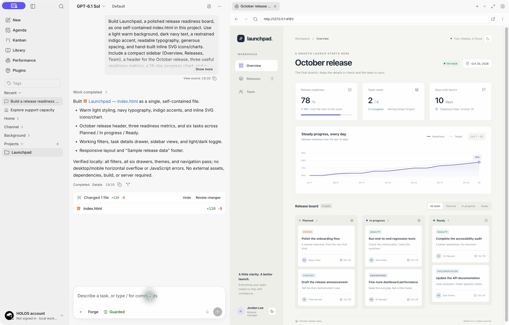
  </a>
</p>

**Build, verify, and preview.** Forge builds an offline release board with GPT-6.1 Sol, verifies its interactions, and previews it in Desktop's native Browser. [View the generated HTML](.github/assets/readme/demos/launchpad.html).

<p align="center">
  <a href=".github/assets/readme/synergy-visual-results.png">
    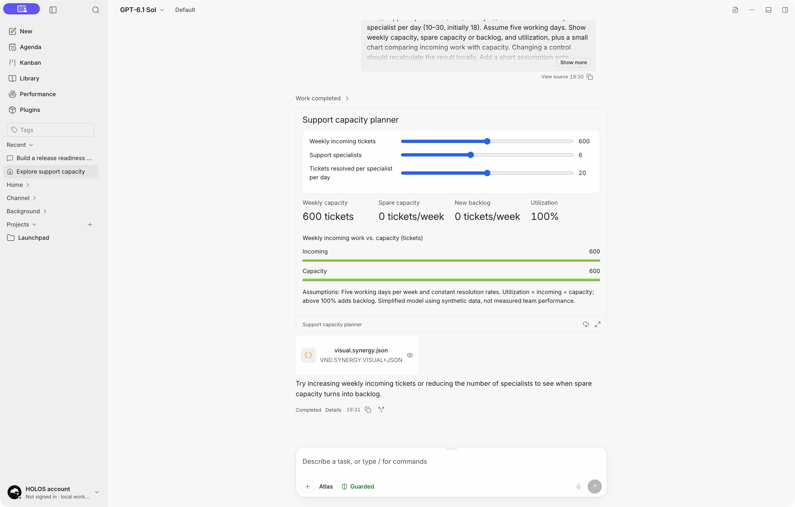
  </a>
</p>

**Interactive results, without allocating compute.** Atlas creates a support-capacity planner in a Session with no Workspace or Environment. Changing a slider recalculates the native controls and chart locally, and the selected parameters persist with the result. The screenshot uses six specialists, twenty tickets per day, and a five-day week: 600 tickets of weekly capacity. [View the render input](.github/assets/readme/demos/support-capacity.json).

Both demonstrations use actual GPT-6.1 Sol responses and synthetic data in an isolated Desktop instance. The [release board](.github/assets/readme/demos/launchpad.html) works offline; the capacity planner uses Synergy's [native visual result catalog](docs/architecture/visual-results.md). These images show local execution and API-only work; they are not evidence of a multi-machine deployment.

|            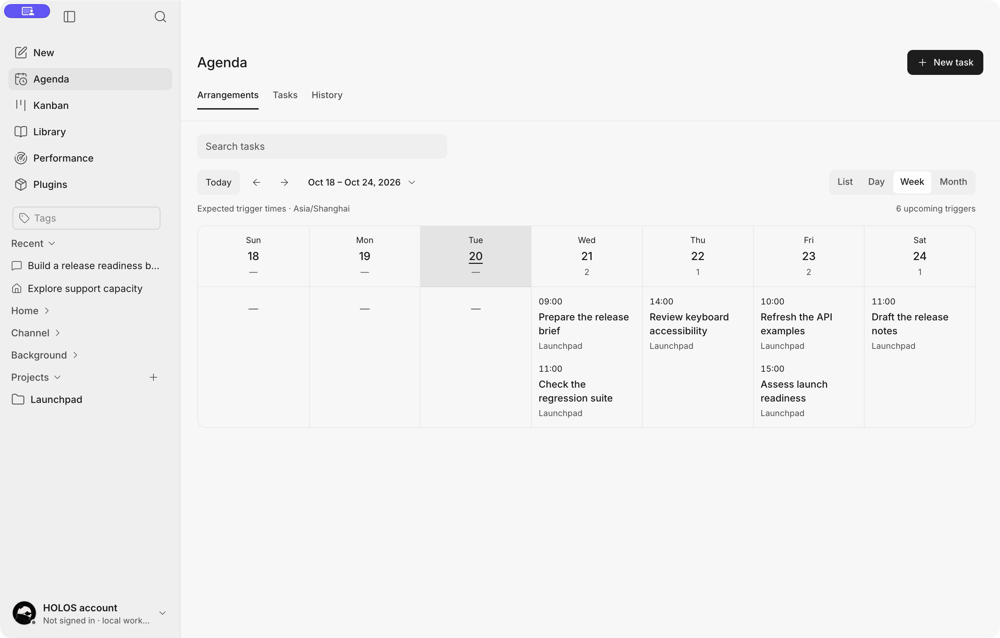            | 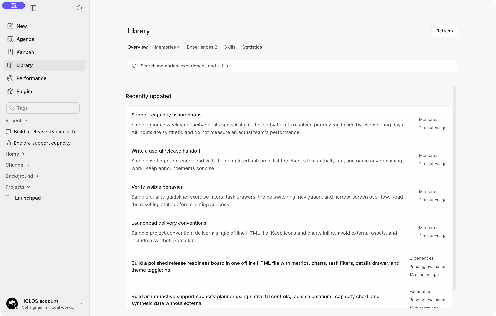 |
| :--------------------------------------------------------------------------------------------------------------------------------------------------------: | :-----------------------------------------------------------------------------------------------------------------------------------------------------------: |
|                               **Agenda** — arrange agent work on a calendar and inspect trigger rules and execution history.                               |                                  **Library** — retain project knowledge and review experience captured from completed work.                                   |
| 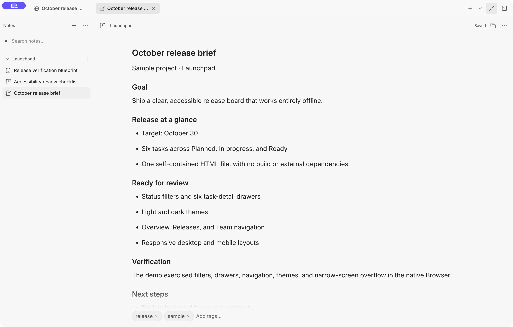 |         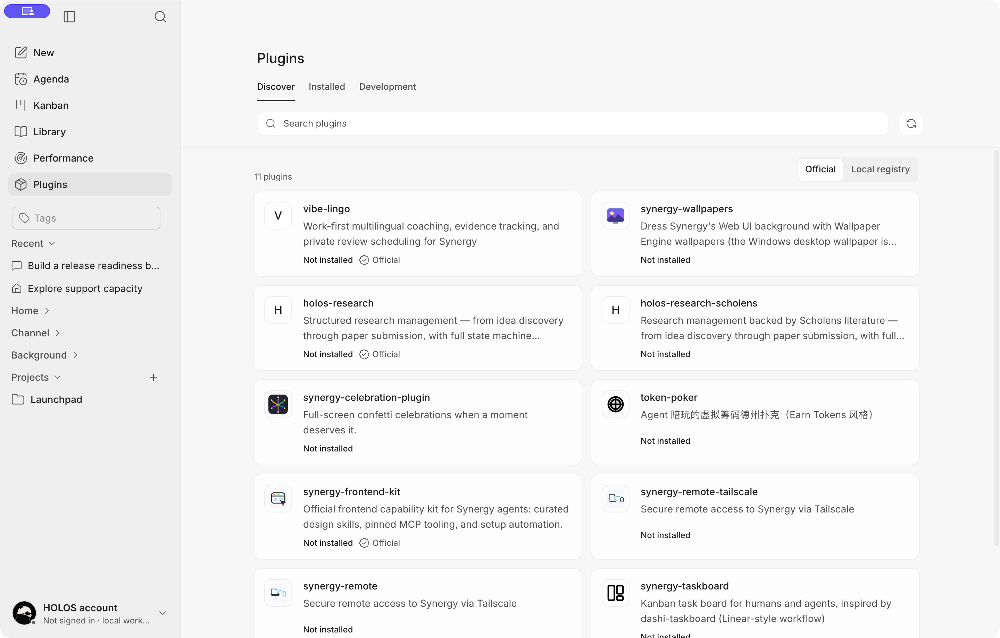          |
|                                **Notes and Blueprints** — keep briefs, checklists, and executable plans alongside the task.                                |                                  **Plugins** — discover extensions for research, design, remote access, and other workflows.                                  |

The gallery uses sample project content. Agenda entries were paused after capture; the Library's experience records come from the two actual demo runs and retain their pending-evaluation state.

## Benchmarks

On the [DeepSWE v1.1](https://deepswe.datacurve.ai) benchmark — 113 real repository engineering tasks — the same model completes far more work under Synergy than under its stock harness. Running deepseek-v4-flash with the coding agent **Forge** lifts Pass@1 from **53% to 67.3%** (+14.3pp, 1.27×) at **$0.54/task**, landing on the cost-performance Pareto front.

<p align="center">
  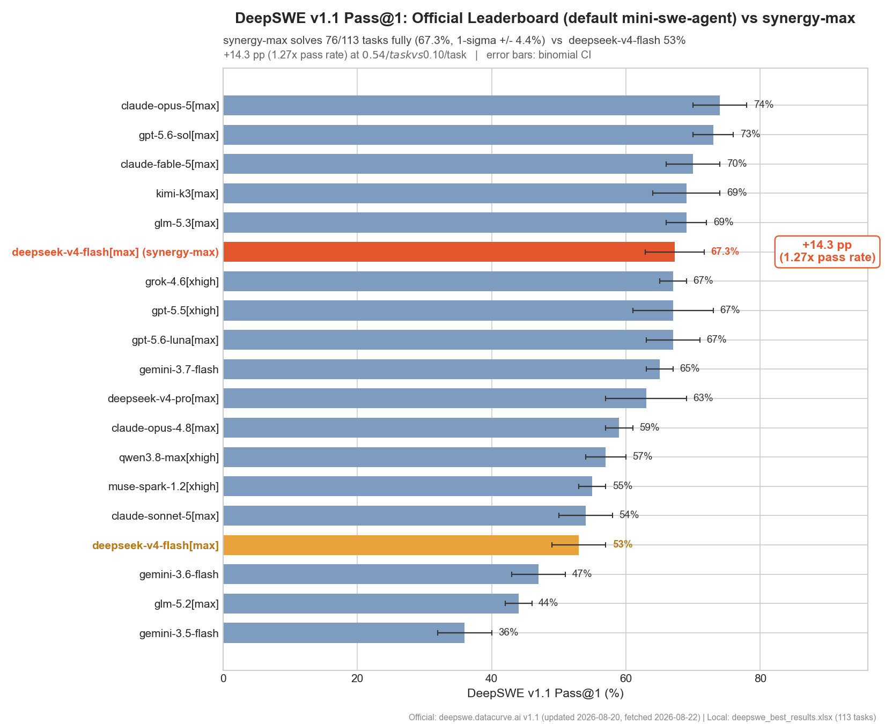
  &nbsp;
  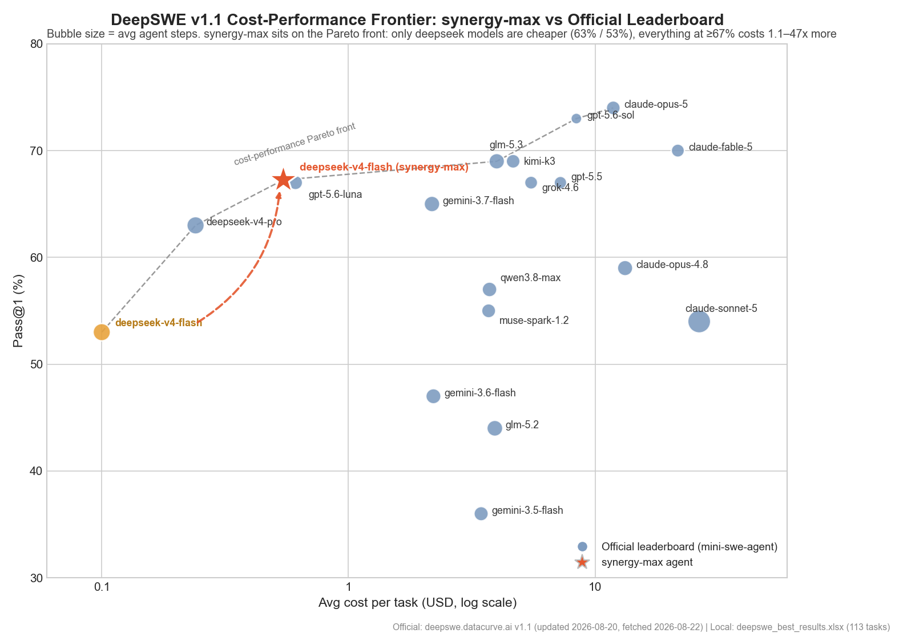
</p>

<p align="center"><sub>Pass@1 across 19 leaderboard configurations (left) and the cost-performance frontier (right): the coding agent (orange) vs the official mini-swe-agent run of the same model (yellow).</sub></p>

<p align="center">
  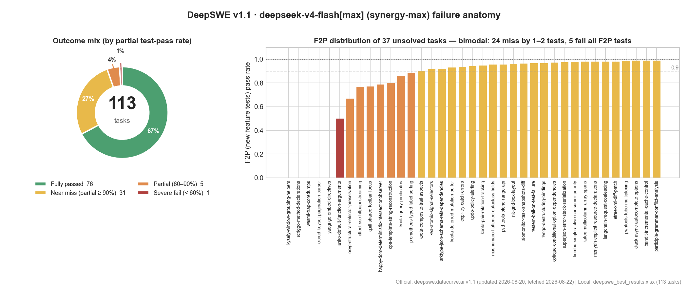
</p>

<p align="center"><sub>Failure anatomy: 76/113 tasks fully passed; 24 of the 37 unsolved tasks miss by only 1–2 tests.</sub></p>

<p align="center">
  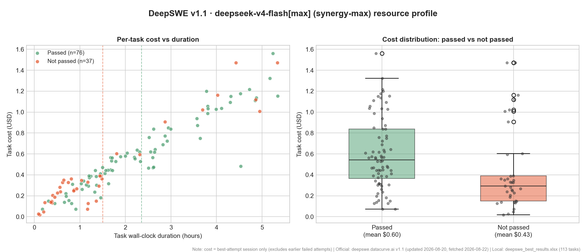
  &nbsp;
  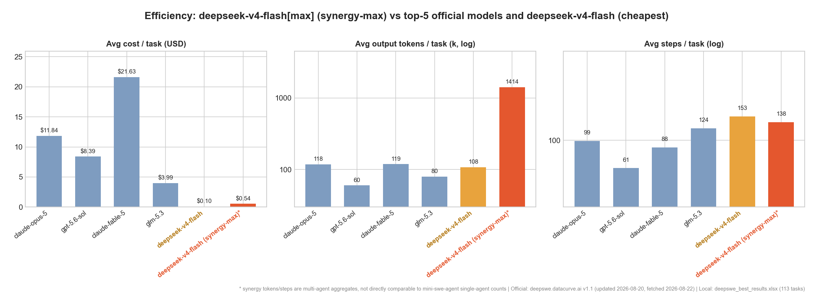
</p>

<p align="center"><sub>Resource profile (left): passed tasks average $0.60 over ~2.3h. Efficiency vs the top-5 official models and the cheapest baseline (right): $0.54/task — 7–40× cheaper, with token/step counts aggregated across subagents.</sub></p>

Methodology: official leaderboard numbers from deepswe.datacurve.ai (v1.1, fetched 2026-08-22); Synergy numbers from local full-benchmark runs. All costs are computed at the API prices in effect **before** 2026-08-17 00:00 (Beijing time) — **prior to** DeepSeek's across-the-board price increase and peak/off-peak pricing.

## Quick Start

### Desktop

Choose a project in the task composer or start without project files. See [project task entry](docs/product/workspaces-and-sessions.md#starting-a-project-task) for file locations and independent copies.

Download the latest installer from [GitHub Releases](https://github.com/SII-Holos/synergy/releases/latest). Desktop installers include the app and expose the packaged runtime as the `synergy` CLI.

| Platform | Installer   |
| -------- | ----------- |
| macOS    | `.pkg`      |
| Windows  | NSIS `.exe` |
| Linux    | `.deb`      |

Portable artifacts are also published, but they do not configure a system CLI. Windows Desktop and CLI releases currently support x64.

For an existing 3.0.22 installation, follow the [3.1.0 upgrade and recovery guide](docs/migrations/upgrading-to-3.1.0.md) before replacing the distribution.

### CLI and Web

Install the current release:

```bash
curl -fsSL https://raw.githubusercontent.com/SII-Holos/synergy/main/install | bash
```

Configure a model provider, start the background runtime, and open the Web client:

```bash
synergy config wizard
synergy start
synergy web
```

Run one task directly from the terminal:

```bash
synergy send "summarize this repository"
```

Useful runtime commands:

```bash
synergy status
synergy logs
synergy doctor
synergy stop
```

The CLI installer places the launcher and its sealed module graph under `~/.synergy/`; setting `SYNERGY_HOME=/path` changes that root to `/path/.synergy/`. It does not install the Electron Desktop app.

You can keep one Synergy installation per channel — the standalone CLI, a supported package-manager install (`npm`, `yarn`, `pnpm`, or `bun`), and the Desktop app — but only one should be the `synergy` command your shell runs. `synergy doctor` lists every detected installation channel and exits nonzero when channels conflict or an installed version cannot be verified. The curl installer and the npm package postinstall warn about other channels they detect and never auto-uninstall them. Homebrew's `synergy` formula is unrelated to this project and is not detected or managed.

Upgrade with `synergy upgrade`, or install a specific version by passing `--version <version>` to the installer. When multiple channels are installed, `synergy upgrade` stops instead of guessing: rerun with `--method <npm|yarn|pnpm|bun|desktop|standalone>` to select an installed, healthy channel.

`synergy uninstall` keeps its existing defaults and removes data, cache, config, and state unless you pass `--keep-data` or `--keep-config`. To remove only one installation channel while preserving shared data, cache, config, and state, run `synergy uninstall --installation-only --method <channel>`; standalone removal deletes only installer-owned files under `~/.synergy/` and the exact shell PATH entries the installer wrote.

The built-in Browser is Desktop-local and uses Electron's bundled Chromium, with per-session workbench page tabs and reusable website logins; separate and temporary profiles live in Browser settings. CLI and Web use search, fetch and MCP integrations. macOS Desktop also supports native application Computer Use in Full Access mode, with independently checked Accessibility and Screen Recording permissions. Native observations report image quality and action availability; coordinate actions require a verified image submitted to the selecting model request. Computer Use prefers background delivery. The agent can explicitly request foreground observation or input when needed; actions never automatically escalate or replay, and a fresh observation verifies the result. See [Native Computer Use](docs/architecture/computer-use.md).

Holos is optional. Connect an agent from the Web account surface or run `synergy holos login`.

See the [CLI reference](docs/reference/cli.md), [configuration reference](docs/reference/configuration.md), and [release notes](https://github.com/SII-Holos/synergy/releases) for complete setup and runtime details.

For headless tasks, versioned experiment settings, durable execution evidence and cost comparisons, see [Rollout execution](docs/reference/rollout.md).

## Product Surfaces

| Surface            | Purpose                                                                                                                                                         |
| ------------------ | --------------------------------------------------------------------------------------------------------------------------------------------------------------- |
| Web                | Primary workbench for sessions, project files, Notes, Library, Agenda, plugins, settings, and operational views.                                                |
| Desktop            | Electron product with a managed packaged server, native Browser presentation, local folder selection, protocol handling, keep-awake while running, and updates. |
| CLI                | Runtime management, one-off `send` execution, configuration, sessions, integrations, diagnostics, and development workflows.                                    |
| Server API and SDK | Shared contract used by first-party clients and integrations.                                                                                                   |

## Develop Synergy

Synergy is a Bun monorepo using TypeScript ESM modules. The pinned package manager is declared in [`package.json`](package.json).

Install Rust with Cargo for the native PTY and Linux process ownership library, then prepare a source checkout:

```bash
bun dev prepare
```

See the [development reference](docs/reference/development.md#requirements-and-preparation) for preparation requirements and macOS Desktop native-driver build status.

Common development flows:

```bash
bun dev server
bun dev app --open
bun dev web
bun dev desktop
bun dev desktop --managed
bun dev send "your message"
```

Default local preflight:

```bash
bun run verify plan
bun run verify local --test test/script/dev-entrypoints.test.ts
bun run verify stability --test packages/util/test/fs-lock-delete-pending.test.ts --batch --repeat 5
```

For Bun embedding, use `openAgentRuntime({ home, components })` from `packages/agent-runtime` and select optional component factories explicitly. For lower-level hosts, `packages/harness` exposes the execution and lifecycle APIs, and `packages/local-runtime` supplies local tools, native execution and provider SDKs. `packages/cli` keeps the same `synergy` command, with commands supplied by the selected components; the complete product composes optional capabilities in `packages/presets`. Hosts can compose independent Runtime instances in one process with explicit home, environment and storage ownership. Home sessions work without a local workspace. Node.js uses the managed HTTP SDK or attaches to an existing runtime. See [Embedding](docs/reference/embedding.md), [Installable packages](docs/reference/installable-packages.md), [Runtime and Scope](docs/architecture/runtime-and-scope.md) and the [package map](docs/reference/packages.md).

Install the minimal CLI with Bun, then select capabilities:

```bash
bun add --global @ericsanchezok/synergy-cli
synergy install mcp lsp
synergy install web
synergy install desktop
```

The existing `@ericsanchezok/synergy` distribution and Desktop installer retain the complete product by default. Use `synergy install`, `list`, `update` and `remove` to manage optional packages. Agenda, Light Loop, Channels, Email and other leaf capabilities can be selected independently. Unselected capabilities contribute no UI, model guidance or callable API; their data is retained for reinstall. `workflows` and `connections` select complete declarative presets. Components, process plugins, company presets and native applications share package discovery while retaining distinct trust and capability approval. See [installation commands](docs/reference/packages.md#installation-commands) for sources, unattended approval and recovery.

Local performance experiments use the [benchmark workspace](benchmark/README.md): independent harness/model matrices, frozen inputs, native rollout evidence and paired reports. Task solving, reference execution and verification each have a fixed three-hour budget. Run `bun bench run benchmark/configs/local24-boyue.yaml` after configuring its model endpoint and credential reference. Formal tasks start directly in unattended sessions. Adaptive working-set reservations keep independent cells running within live resource limits; reports retain per-task failures and unknown usage. The local-24 preset uses GLM 5.3 Flash with explicit low reasoning.

Harness runtime tests run from `packages/harness`:

```bash
cd packages/harness
bun test
bun run test:ci # Isolated batches; CI adds coverage in the same execution
```

Frontend package suites run through their standard scripts and are included in `bun run quality`:

```bash
bun run --cwd apps/web test
bun run --cwd packages/ui test
```

Browser capability or App bootstrap changes also verify the source boundary and a genuine non-loopback HTTP origin:

```bash
bun test --cwd apps/web test/testing/browser-crypto-contract.test.ts
bun run --cwd apps/web build
bun apps/web/script/private-http-smoke.ts
```

CI planning, bounded execution, diagnostics and justified runtime growth are documented in [CI verification](docs/operations/ci.md). Review new and affected existing tests with [testing-guide](.synergy/skill/testing-guide/SKILL.md#review-test-value-and-ci-cost).

Tests live under each package's `test/` directory; repository-level tests live under the root `test/` directory. `bun run quality:quick` enforces this layout.

Frontend product copy is extracted into English and Simplified Chinese catalogs, plus a development-only pseudo catalog. Changes to visible text or locale formatting also run:

```bash
bun run --cwd apps/web i18n:extract
bun run localization:check
```

When developing Synergy while using Synergy itself, start an isolated second instance with a separate `SYNERGY_HOME` and explicit ports. Never stop or replace the instance hosting your active session. The [development reference](docs/reference/development.md) contains the complete workflow.

## Develop Plugins

Plugin authors can start without cloning this repository:

```bash
bunx @ericsanchezok/synergy-plugin-kit create my-plugin --template tool-ui
cd my-plugin
bun install
synergy-plugin build
synergy-plugin validate --runtime-discovery
```

UI API 6 supports replaceable workbenches, typed frontend services and structured Skins. `synergy-plugin preview` runs an isolated production host for authoring.

Approved connection providers can discover and pair devices for [manual paused-task migration](docs/architecture/session-transfer.md), with [Harness-owned device authorization](docs/architecture/host-connections.md).

Start with the [plugin documentation](docs/plugins/README.md) and the [`@ericsanchezok/synergy-plugin` API reference](packages/plugin/README.md).

## Documentation

The [documentation home](docs/README.md) routes readers by product area and task.

- [Product overview](docs/product/overview.md) — product purpose, objects, workflows, and boundaries
- [Architecture](docs/architecture/README.md) — runtime invariants and implementation ownership
- [CLI reference](docs/reference/cli.md) — installed and source-checkout commands
- [Configuration reference](docs/reference/configuration.md) — domains, precedence, providers, and instructions
- [Storage and paths](docs/reference/storage-and-paths.md) — persistent state and workspace layout
- [Plugin documentation](docs/plugins/README.md) — definitions, generated artifacts, capabilities, runtime, UI, and publishing
- [Oryn maintenance](docs/operations/oryn.md) — repository Actions, triage and validated repairs
- [Contributing](CONTRIBUTING.md) — repository setup and pull request workflow

Coding agents and LLM tools should begin with [llms.txt](llms.txt). Read [AGENTS.md](AGENTS.md) only when modifying the Synergy repository; plugin authors do not need the repository agent guide.

## About Shanghai Innovation Institute <a href="https://www.sii.edu.cn" target="_blank" rel="noopener noreferrer"></a>

**Shanghai Innovation Institute (SII / 上海创智学院)** is a research institute dedicated to AI and large model innovation, based in Shanghai. The Holos team at SII builds Synergy as part of its open-source AI platform work.

🌐 [https://www.sii.edu.cn](https://www.sii.edu.cn)

Kanban, Boss mode and Lattice are experimental and default off, including after upgrades. Enable them in Settings → Experimental features and restart Synergy. Disabling preserves their data and business settings. See [feature lifecycle](docs/architecture/feature-lifecycle.md).

## Contributing and Security

Contributions, bug reports, and feature ideas are welcome. Read [CONTRIBUTING.md](CONTRIBUTING.md), follow the [Code of Conduct](CODE_OF_CONDUCT.md), and use the repository's [security reporting process](.github/SECURITY.md) for vulnerabilities rather than opening a public issue.

Synergy is open source under the [MIT License](LICENSE).

Agent records use transactional SQLite by default, with an explicit PostgreSQL option. Binary evidence uses checksummed packs. Existing Home data upgrades through resumable migration. Optional whole-database optimization runs in an explicit maintenance window; committed data opens without waiting for space reclamation. Desktop offers retry, maintenance continuation and startup diagnostics when launch fails. Eligible upgrades admit new work while history prepares in the background. Open old conversations on demand, or pause background preparation from the status bar. Preserve frozen originals and protected snapshot paths until the independent recovery backup is complete. See [Agent storage](docs/architecture/agent-storage.md) and [storage operations](docs/reference/storage-and-paths.md).
